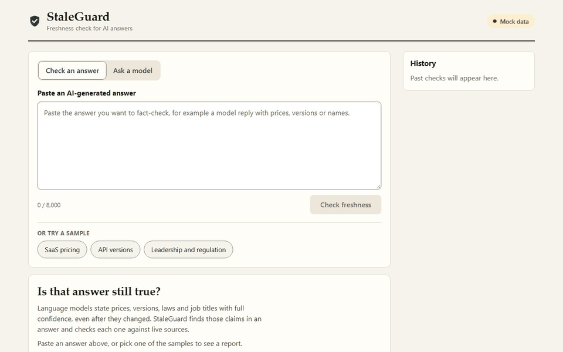
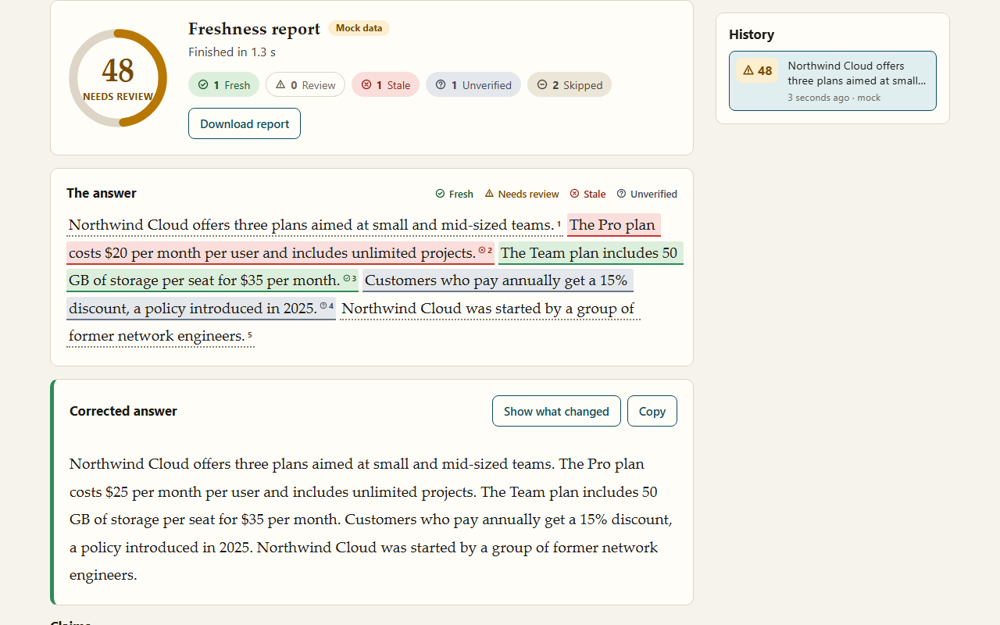
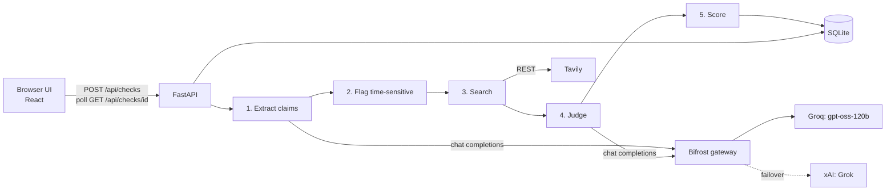

# StaleGuard

StaleGuard finds time-sensitive claims in an LLM answer, re-checks each one against the live web and scores how fresh it is.



**Demo video:** <!-- DEMO VIDEO LINK -->

[](https://github.com/6rzan/ai-global-hackathon/actions/workflows/ci.yml)
[](LICENSE)

## Quick start

```bash
git clone https://github.com/6rzan/ai-global-hackathon && cd ai-global-hackathon && docker compose up
```

Then open http://localhost:8000.

This runs in mock mode. It needs no API keys and makes no network calls. The answers, sources and verdicts come from bundled fictional fixtures (invented companies, `example.com` URLs), and the UI labels them as mock data.

### Without Docker

You need Python 3.11+, [uv](https://docs.astral.sh/uv/) and Node 22+. Use two terminals from the repo root.

```bash
cd backend && uv sync && cd ../frontend && npm ci && cd ..
cp .env.example .env     # optional: the default is already MOCK_MODE=true
make dev-backend         # API on http://localhost:8000
make dev-frontend        # UI on http://localhost:5173, proxies /api to port 8000
```

Without `make` (for example on Windows), run the same targets by hand, one per terminal:

```bash
cd backend && uv run uvicorn app.main:app --reload --port 8000
cd frontend && npm run dev
```

Open http://localhost:5173. The first command installs both sets of dependencies and only needs to run once.

## What it does

The hackathon problem (PS06) asks for four things. This is how each one is covered.

| Requirement | What StaleGuard does |
|---|---|
| Claim identification | A model reads the answer and returns each factual claim as an exact piece of the original text, with a category (pricing, version, regulation, leadership, company fact, statistic, other). |
| Freshness detection | Each claim is marked time-sensitive or not, with a volatility level (high, medium, low) and a one-line reason. Only time-sensitive claims are searched, highest volatility first, up to `MAX_CLAIMS` per check. |
| Live verification | Tavily searches the web for each flagged claim. A model then judges the claim against the numbered sources: current, outdated or unverified, with the value the sources give now. |
| Freshness scoring | Every verified claim gets an integer score from 0 to 100 and a label (fresh, review, stale, unverified), with a visible breakdown. The check gets an overall score. |

Also in the app:

- Ask mode: type a question, a model answers it, then the answer is checked.
- Corrected answer: when claims are outdated and the sources give a current value, the answer is rewritten with only those statements changed, available as a word diff against the original.
- Cache: a verified claim is reused for 6 hours (high volatility), 24 hours (medium) or 7 days (low). Cached claims are marked in the UI. Turn it off with `CACHE_ENABLED=false`.
- History: every check is stored in SQLite and listed in the UI.
- Export: "Download report" saves the check as a Markdown file.
- JSON API: `POST /api/checks?wait=true` returns the finished check, so it can sit behind another tool as a verification step.



## How it works



The pipeline in `backend/app/pipeline.py`:

1. Ask mode only: a model answers the question.
2. Extract: one model call returns the claims. Each claim's text is located in the answer by exact match; a claim that is not a real substring is dropped.
3. Flag: timeless claims are skipped. The rest are sorted by volatility and cut to `MAX_CLAIMS`.
4. Search: one Tavily search per flagged claim.
5. Judge: one model call per claim with its numbered sources. No sources means `unverified` and no model call.
6. Score: a fixed formula, no model involved.
7. Rewrite: if any claim is outdated with a known current value, one more call produces the corrected answer.

Up to four claims are verified at the same time. The check is saved after every step, and the UI polls once a second, so claims fill in as they finish. One claim failing does not fail the check.

### Freshness score

The score is computed in `backend/app/scoring.py`, not by a model.

```
half_life_days = pricing 90, version 120, leadership 180, regulation 365,
                 company_fact 365, statistic 365, other 365

recency   = mean of exp(-age_days / half_life) over sources that support or contradict
            (0.5 for a source with no date, 0.5 if there are none)
agreement = share of those sources that agree with the verdict
            (supports for current, contradicts for outdated; 0.5 if none)
quality   = confidence * (0.5 * recency + 0.5 * agreement)

current    -> round(65 + 35 * quality)     65 to 100
outdated   -> round(35 * (1 - quality))     0 to 35
unverified -> round(50 - 15 * volatility)   volatility: high 1, medium 0.5, low 0

label: unverified stays unverified; otherwise 75+ fresh, 40 to 74 review, below 40 stale
overall score: mean of the claim scores, rounded
```

Worked example, from a real mock-mode run on the bundled "SaaS pricing" sample (14 Nov 2026, mock data):

- Claim: "The Pro plan costs $20 per month per user and includes unlimited projects."
- Category pricing (half-life 90 days), volatility high.
- Three mock sources: two contradict the claim (published 2026-10-02 and 2026-09-15), one is neutral.
- Judge verdict: outdated, confidence 0.9.
- recency 0.57, agreement 1.0, so quality = 0.9 * (0.5 * 0.57 + 0.5 * 1.0) = 0.71.
- Score = round(35 * (1 - 0.71)) = 10, label stale.
- The same check scored its other claims 91 (fresh) and 43 (unverified, no mock sources), and 48 overall.

The recency number depends on the date of the run because the mock sources are dated relative to today.

## How Bifrost is used

[Bifrost](https://docs.getbifrost.ai) is the gateway between the app and the model providers. The app never talks to Groq or xAI directly and never holds a provider key. The client is `backend/app/llm.py`.

- Endpoint: `POST {BIFROST_BASE_URL}/v1/chat/completions`, the chat completions route. Models are named `provider/model`, for example `groq/openai/gpt-oss-120b` (provider `groq`, model id `openai/gpt-oss-120b`).
- Request body: `model`, `messages`, `temperature: 0`, `response_format: {"type": "json_object"}` for extract and judge, and `fallbacks` set from `MODEL_FALLBACKS` when it is not empty.
- Per-stage routing: `MODEL_EXTRACT` (structured output), `MODEL_JUDGE` (reasons over sources, also used for the rewrite) and `MODEL_ANSWER` (ask mode). Changing a model is an env change, not a code change.
- Why this split: the high-volume structured stages (extract, judge, rewrite) run on an open-weight model on Groq, which is fast and cheap per call. The answer in ask mode comes from a different vendor, xAI Grok, so StaleGuard checks a model it did not use to judge, and Grok is also the failover if Groq fails. Moving a stage to another provider is an env change only; the gateway and the app code stay the same.
- Headers: `Authorization: Bearer` when `BIFROST_API_KEY` is set, and `x-bf-vk` when `BIFROST_VIRTUAL_KEY` is set, so the gateway can apply budgets and rate limits per app.
- What the app reads back: `choices[0].message.content`, `usage.prompt_tokens` and `completion_tokens`, and which provider and model served the call from `extra_fields.routing_info` (falling back to the `model` field).
- Where it shows: the "Models via Bifrost gateway" strip under each result lists one entry per stage with the model requested (the judge entry shows a count, one call per claim). When a fallback answered, the entry gets a "fallback" tag with the model that served it. The strip also shows totals for tokens, searches, cache hits (when there are any) and duration. Per-call latency and token counts are in the API response (`model_calls`), not in the strip. `GET /api/health` reports the configured models.
- Virtual key: the app has its own Bifrost virtual key (`vk-staleguard` in `bifrost/config.json`, value from `BIFROST_VIRTUAL_KEY`, sent as `x-bf-vk`). The gateway enforces a budget of 5 USD per day and 60 requests per minute on it, and only lets it use the two configured models.
- The provider keys live only in the Bifrost container, loaded from `bifrost/config.json` (`env.GROQ_API_KEY`, `env.XAI_API_KEY`). Every request also shows up in the Bifrost dashboard on port 8080.

## How Tavily is used

[Tavily](https://tavily.com) supplies the live evidence. The client is `backend/app/search.py`.

- Endpoint: `POST https://api.tavily.com/search` with `Authorization: Bearer <TAVILY_API_KEY>`.
- Request body: `query` (the claim's search query), `topic` (`news` for leadership and company-fact claims, `general` otherwise), `max_results: 5`, `include_answer: true`, `include_published_date: true`, `search_depth: basic`.
- What the app reads back: for each result the title, URL, content (cut to 500 characters), relevance `score` and `published_date` (normalised to ISO 8601 UTC), and Tavily's short synthesised `answer`, which the judge sees as a hint only.
- How it is used: the judge labels each source as supports, contradicts or neutral. The publication dates feed the recency part of the score.
- Where it shows: each claim card lists its sources under "Sources, live web via Tavily" with title (linked), domain, date, stance and snippet. The relevance score is in the API response (`evidence[].score`), not in the UI. The usage strip counts the searches made.

## Run it with real keys

Live mode sends the answer text to Bifrost and your providers, and the claims to Tavily. Both cost money or free-tier quota. Read the [limitations](#limitations-and-what-is-next) first.

1. Create `.env` and put the keys in it:

   ```bash
   cp .env.example .env
   ```

   Set `MOCK_MODE=false` and `TAVILY_API_KEY=...`. Also set `GROQ_API_KEY`, `XAI_API_KEY` and `BIFROST_VIRTUAL_KEY` (make one with `echo sk-bf-$(openssl rand -hex 24)`); `bifrost/config.json` reads them, and the app sends the virtual key to the gateway. Check that `MODEL_EXTRACT`, `MODEL_JUDGE` and `MODEL_ANSWER` name models your provider keys can use.
2. Start Bifrost, either with the Compose service:

   ```bash
   docker compose --profile live up bifrost
   ```

   or directly with Node. Export `GROQ_API_KEY`, `XAI_API_KEY` and `BIFROST_VIRTUAL_KEY` in that shell first, and point Bifrost at this repo's config:

   ```bash
   npx -y @maximhq/bifrost -app-dir ./bifrost
   ```

   Bifrost listens on http://127.0.0.1:8080 and has a web UI there. Inference calls need the virtual key; the dashboard needs an admin account (see `docs/OWNER_TODO.md`).
3. Run the smoke test. It always uses the real clients, whatever `MOCK_MODE` says:

   ```bash
   make smoke
   # without make: cd backend && uv run python -m app.smoke
   ```

   It checks Bifrost with one extraction call, Tavily with one search, then runs one full check on a throwaway database. Each line starts with PASS or FAIL, and the exit code is 0 only if all three pass:

   ```
   PASS bifrost  served_by=... latency=...ms
   PASS tavily  5 results
   PASS check  status=done claims=[...] overall=... llm_calls=... searches=... duration=...ms
   ```

   A FAIL line names what to check: the gateway address, a missing provider key, an invalid model name, or `TAVILY_API_KEY`.
4. Start the app: `make dev-backend` and `make dev-frontend` (or the raw commands under "Without Docker"). The header badge changes from "Mock data" to "Live: Bifrost + Tavily". If you use Docker for the app too, run `docker compose --profile live up`; Compose points the app at the Bifrost container for you.

## Configuration

All variables are in `.env.example`. The app reads them in `backend/app/config.py`. Existing environment variables win over `.env`.

| Variable | What it is for | Where to get it | Required | Default |
|---|---|---|---|---|
| `MOCK_MODE` | `true` uses bundled fixtures and no network. Anything other than `false` or `0` counts as true. | n/a | Yes | `true` |
| `BIFROST_BASE_URL` | Base URL of the Bifrost gateway. | [Bifrost docs](https://docs.getbifrost.ai) | When `MOCK_MODE=false` | `http://127.0.0.1:8080` |
| `BIFROST_API_KEY` | Bearer key if the gateway has auth turned on. | Your Bifrost setup | No | empty |
| `BIFROST_VIRTUAL_KEY` | Bifrost virtual key sent as `x-bf-vk`. Must start with `sk-bf-`. The gateway reads the same value for `bifrost/config.json`. | Make one: `echo sk-bf-$(openssl rand -hex 24)` | Yes in live mode | empty |
| `BIFROST_SETUP_TOKEN` | Bifrost setup token, used once to create the dashboard admin account. | `openssl rand -hex 32` | No | empty |
| `MODEL_EXTRACT` | Model for claim extraction. | Any model your Bifrost providers serve | Yes | `groq/openai/gpt-oss-120b` |
| `MODEL_JUDGE` | Model for judging evidence and rewriting. | Same | Yes | `groq/openai/gpt-oss-120b` |
| `MODEL_ANSWER` | Model for the ask-mode answer. | Same | Yes | `xai/grok-4.7` |
| `MODEL_FALLBACKS` | Comma-separated models Bifrost tries on failure. | Same | No | empty in the app; `xai/grok-4.7` in `.env.example` |
| `TAVILY_API_KEY` | Tavily search key. | [app.tavily.com](https://app.tavily.com) | When `MOCK_MODE=false` | empty |
| `MAX_CLAIMS` | Most flagged claims verified per check. | n/a | No | `8` |
| `DATABASE_PATH` | SQLite file. | n/a | No | `backend/data/staleguard.db` |
| `GROQ_API_KEY` | Groq key, read by Bifrost, not by the app. | [console.groq.com](https://console.groq.com/keys) | For the Groq models | empty |
| `XAI_API_KEY` | xAI key, read by Bifrost, not by the app. | [console.x.ai](https://console.x.ai) | For the Grok models | empty |
| `CACHE_ENABLED` | Reuse verified claims for a while. | n/a | No | `true` |

`DATABASE_PATH` in `.env.example` is `data/staleguard.db`. A relative path is resolved against the `backend/` folder (`backend/app/config.py` does this), wherever the process starts.

## API

Base path `/api`, JSON everywhere. The full shapes are in [`specs/001-stale-answer-detector/contracts/api.md`](specs/001-stale-answer-detector/contracts/api.md).

| Method | Path | Request | Response |
|---|---|---|---|
| GET | `/api/health` | none | `200` mode, version and configured models |
| GET | `/api/samples` | none | `200` the bundled sample answers |
| POST | `/api/checks` | `{"answer": "..."}` or `{"question": "..."}`, optional `?wait=true` | `202 {"id": "..."}`; with `wait=true`, `200` the finished check |
| GET | `/api/checks` | `?limit=20` (1 to 50) | `200` summaries, newest first |
| GET | `/api/checks/{id}` | none | `200` the check, or `404` |

`answer` is 1 to 8000 characters. With `question` only, the model answers first (ask mode). Validation errors return `422`.

```bash
curl -s -X POST 'http://localhost:8000/api/checks?wait=true' \
  -H 'Content-Type: application/json' \
  -d '{"answer": "The Pro plan costs $20 per month per user."}'
```

Trimmed response from a mock-mode run (mock data, the real response also has `model_calls`, `evidence` per claim and more):

```json
{
  "status": "done",
  "mode": "mock",
  "overall_score": 10,
  "summary": { "fresh": 0, "review": 0, "stale": 1, "unverified": 0, "skipped": 0 },
  "claims": [
    {
      "id": "c1",
      "text": "The Pro plan costs $20 per month per user.",
      "category": "pricing",
      "verdict": "outdated",
      "freshness_score": 10,
      "label": "stale",
      "current_value": "$25 per user per month since September 2026",
      "score_breakdown": { "verdict": "outdated", "confidence": 0.9, "recency": 0.57, "agreement": 1.0, "quality": 0.71 }
    }
  ],
  "usage": { "llm_calls": 3, "search_calls": 1, "cache_hits": 0 }
}
```

## Tests

From the repo root:

| Gate | Command | Covers |
|---|---|---|
| Backend lint | `cd backend && uv run ruff check .` | Python style and import order |
| Backend tests | `cd backend && uv run pytest -q` | 72 tests (last run: 72 passed): score formula, claim spans, the Bifrost and Tavily clients against a mocked HTTP transport, the pipeline, cache, and the API. No network. |
| Frontend lint | `cd frontend && npm run lint` | oxlint with warnings denied |
| Frontend build | `cd frontend && npm run build` | TypeScript check and Vite bundle |

`make test` runs the backend lint, backend tests and frontend lint; `make build` runs the frontend build.

CI (`.github/workflows/ci.yml`) runs these gates on every push and pull request, plus a `docker` job that builds the image, starts it, waits for `/api/health`, and runs one mock check against the container. On Windows, Docker runs inside WSL 2: open `wsl`, then `cd /mnt/c/.../ai-global-hackathon && docker compose ...`. The app image was built and run in WSL Docker with a mock check, and the live profile's gateway started and loaded `bifrost/config.json`; real provider calls still need keys.

## How AI is used in the product

Model calls, and why:

- Extract: finding claims and judging how fast each kind of fact changes needs language understanding.
- Judge: reading search snippets and deciding whether they support or contradict a claim, and what the current value is.
- Rewrite: producing a corrected answer that changes only the outdated statements.
- Answer: ask mode only, to generate an answer worth checking.

Deterministic on purpose: the freshness score. A model gives a verdict, a confidence and a stance per source. The number and label come from the formula above, so the same inputs always give the same score and the breakdown can be read.

How unsupported output is contained:

- A claim must be an exact substring of the answer. Claims that cannot be located are dropped, and the UI highlights claims by their offsets.
- A verdict needs sources. With no search results the claim is `unverified` and no model call is made.
- Stances from the judge are checked against the allowed values; anything else becomes neutral. Confidence is clamped to 0 to 1.
- Invalid JSON from a model is retried once, then reported as an error on that claim or check.
- If a claim fails, it is marked `unverified` with the error shown. The other claims continue.
- The rewrite is told to change nothing but the listed statements, and the UI can show the result as a word diff against the original.

## AI tools used to build this

The hackathon rules ask for this to be stated, so plainly:

- The project was planned, orchestrated and reviewed with Claude Code (Claude Fable 5.2).
- The code was written by Claude Opus and Claude Sonnet subagents, working from written briefs.
- The spec, plan and task list were written by the planner in the GitHub Spec Kit layout.
- The planner chose the problem statement by scoring the six options against the team's criteria. The scores and every later decision are logged in [docs/DECISIONS.md](docs/DECISIONS.md).
- Every batch was reviewed (diff read, gates rerun, browser check for UI changes) before it was committed. The review notes are in [specs/001-stale-answer-detector/validation.md](specs/001-stale-answer-detector/validation.md).
- The team wrote the brief that set the goal, the constraints, the default stack and the review rules, and owns the result.

## Project layout

```
backend/
  app/          FastAPI app: pipeline, scoring, llm (Bifrost), search (Tavily),
                mock adapters, SQLite store, smoke test, fixtures/
  tests/        pytest suite
frontend/
  src/          Vite + React + TypeScript UI, plain CSS
bifrost/        config.json for the Bifrost container (provider keys come from env)
specs/          Spec Kit: spec, plan, tasks, API contract
docs/           team, decisions, owner to-do, launch and pitch material
Dockerfile      builds the frontend, serves it from the backend
docker-compose.yml   app (mock by default) and the live-profile Bifrost service
Makefile        dev, test, build and smoke commands
```

## Team

| Member | Area |
|---|---|
| Esam Al-Areqi (team leader) | Repo setup, CI, README, docs, pitch deck, demo |
| Taha Thabit | Core engine and backend, Bifrost and Tavily integration, Docker |
| Saadat Ahmed | Prompts (the claim and judge agents), mock adapters, fixtures, tests, smoke test |
| Alaa Aldeen Alhakami | Frontend and UI |

Areas are ownership, not authorship; how the code was written is described under AI tools used to build this.

More in [docs/TEAM.md](docs/TEAM.md).

## Limitations and what is next

- No real Bifrost or Tavily call has been made from this repo yet. The two live clients are tested against a mocked HTTP transport written from the current Bifrost and Tavily docs. The smoke test (`make smoke`) is the step that proves the live path with real keys; until it passes, treat live mode as untested.
- English only. The prompts and the mock rules assume English text.
- No authentication and no users. Anyone who can reach the port can run checks, and in live mode that spends your keys. The Compose file publishes ports on 127.0.0.1 only. Do not expose it more widely without adding auth.
- Live quality depends on the models you configure. A weaker model can miss claims or misjudge a source, and Tavily's snippets are short, so some claims end as `unverified`.
- A source's date is whatever Tavily returns. A source with no date counts as neutral recency (0.5).
- Pasted answers are limited to 8000 characters (longer ones get a `422`); questions to 2000. A generated answer longer than 8000 is cut at a sentence boundary.
- Next: use Bifrost's MCP gateway so the model can call Tavily as a tool and decide when to search, instead of the fixed search-then-judge order.

## License

[MIT](LICENSE)

Built for the Global AI Hackathon 2026, problem statement PS06 (Tavily and Bifrost).
